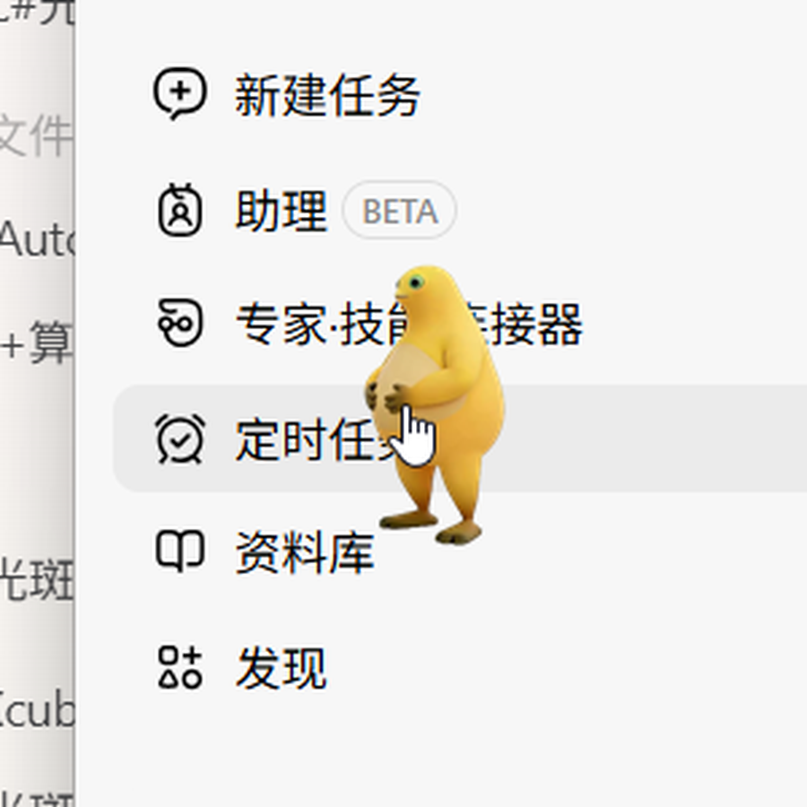
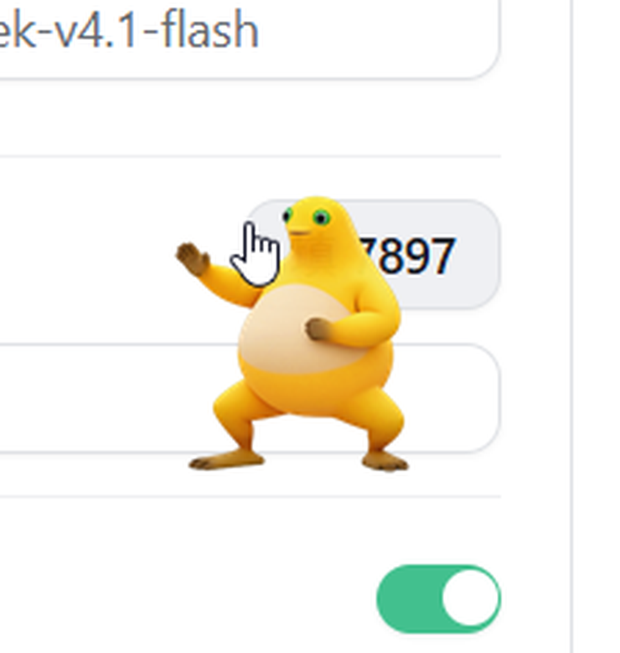

# 奶蛙抱鼠标（Naiwa Cursor Pet）

一只贴在鼠标指针上的奶蛙桌宠。Windows 10/11，纯 C# WinForms，无第三方依赖。

<p align="center">
  
  
</p>

指针固定在它头和肚子之间的空白处，所以走动时它像是被"拎着"一起走。它不会被点到——
窗口是鼠标穿透的，不挡你操作，也不进 Alt+Tab。

## 它会做什么

| 状态 | 触发 | 表现 |
|---|---|---|
| 站立 | 默认 | 每隔 2.5~7 秒眨一次眼 |
| 伸手 | 指针变成手型（悬停在按钮/链接上） | 换成单手前伸的姿势 |
| 大笑 | 双击 | 播完整 422 帧大笑动画（30fps），甩一下鼠标可打断 |
| 躺平 | 鼠标 30 秒不动 / 笑完 | 躺下，一动就醒 |

## 快速开始

**直接用**：到 [Releases](../../releases) 下载 `奶蛙抱鼠标.exe`，双击运行即可。
单文件、自带 .NET 运行时，不需要安装任何东西。退出在托盘图标右键。

**自己编译**：

```bash
# 1. 取素材（会从原作者的素材包下载约 25MB 并生成帧，素材不进本仓库，原因见下方许可）
python tools/prepare_assets.py

# 2. 出单文件
cd src
dotnet publish -c Release -r win-x64 --self-contained true -p:PublishSingleFile=true -o ../dist
```

需要 .NET SDK 8+（用 10 开发验证）和 Python 3 + Pillow。

## 托盘菜单

- **大小**：小 / 中 / 大
- **双击时大笑**：它是鼠标穿透的，收不到自己的点击，所以判断的是全局双击——桌面上任何地方双击都会触发。嫌吵就关掉
- **置顶** / **退出**

## 一些实现细节

- **分层窗口 + 逐像素透明**：`WS_EX_LAYERED | WS_EX_TRANSPARENT | WS_EX_NOACTIVATE | WS_EX_TOOLWINDOW`，
  内容用 `UpdateLayeredWindow` 贴 32bpp 预乘 alpha 位图，所以边缘干净、无黑底。
- **位置硬跟随**：不做平滑插值。早期版本加了惯性，甩鼠标时会"甩过头再荡回来"，观感很差，已改成
  窗口位置 = 光标 − 锚点，实测误差 0px。
- **锚点是手工标的**：站姿 `(55,73)`、单手姿势 `(99,73)`（源图 288×368 坐标系）。
  两张图按**绿色瞳孔质心**对齐，切换姿势时头身不跳，只有手臂动。
- **悬停检测**：比较 `GetCursorInfo().hCursor` 与 `LoadCursorW(NULL, IDC_HAND)`。
  Chromium/Electron、Office、常见 IDE 用的都是系统手型光标，能识别；软件自带手型光标的识别不到。
- **DPI 适配**：`MonitorFromPoint` + `GetDpiForMonitor(MDT_EFFECTIVE_DPI)` 取光标所在显示器的有效 DPI，
  尺寸按 `预设 × dpi/96` 缩放，多显示器混用不同缩放比时跨屏自动重算，最大封顶 280px。
- **素材嵌入**：430 张 PNG 编进 exe，运行时从清单资源读，所以只有一个文件、没有外部依赖。
- **大笑动画按需解码**：422 帧不全量预载，播到哪帧解哪帧并缓存，避免启动卡顿。

## 已知限制

- 只发布了 win-x64。ARM 版 Windows 需要自己改 `RuntimeIdentifier` 重新编译。
- 托盘里的设置目前不持久化，每次启动回默认。
- 首次运行单文件程序会自解压到 `%TEMP%\.net`，个别杀软会因此误报。
- 只对系统手型光标有反应，自定义光标的场景不会触发"伸手"。

## 素材来源与许可

奶蛙形象本身是网络迷因（来历见 [维基百科](https://zh.wikipedia.org/wiki/奶龙) 相关段落），
本项目使用的 3D 渲染素材来自桌宠项目 **[yugh6/NaiJia](https://github.com/yugh6/NaiJia)**，
其许可是 **PolyForm Noncommercial License 1.0.0**：

- 仅限**非商业**用途
- 分发时必须随附该许可文本（见 [NOTICE.md](NOTICE.md)）
- 因此这些图片**不内置在本仓库**，构建时用脚本从原仓库获取

**代码**（`src/`、`tools/`）以 MIT 许可发布，见 [LICENSE](LICENSE)。
代码和素材的许可是分开的，请注意区分。
